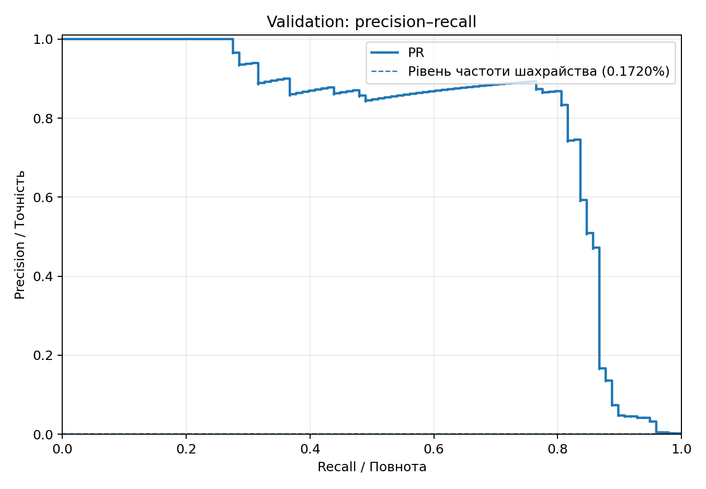
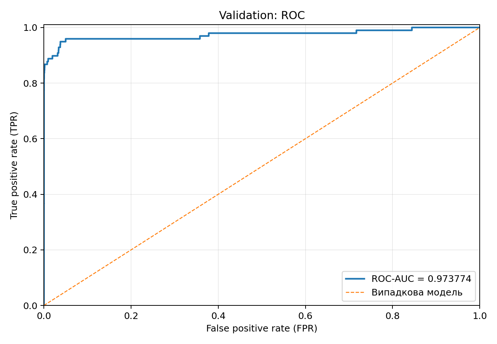

# Лабораторна робота № 2. Поріг рішення під асиметричну ціну помилок
**Середовище:** Python 3.12, CPU, PyTorch, float32.

## Мета

Навчити фіксовану двошарову MLP для виявлення шахрайських транзакцій і, **не змінюючи ваги**, підібрати поріг рішення, що мінімізує асиметричну вартість хибних рішень. Вартість пропущеного шахрайства дорівнює 10, хибного спрацювання — 1:

$$
C(t)=10\,FN(t)+FP(t).
$$

**Джерело набору:** [Credit Card Fraud Detection, Kaggle / ULB](https://www.kaggle.com/datasets/mlg-ulb/creditcardfraud).

## Структура

- `train.py` — **один** запуск навчання, збереження `results/model_weights.pt`, `split_indices.npz`, `scaler.npz`, `predictions.npz` з неокругленими оцінками та сирим `Amount`.
- `threshold.py` — підрахунок TP, FP, FN, TN, C та швидкий пошук усіх порогів.
- `verify.py` — незалежне пряме обчислення кандидатів на наборах A, B, C; перевірка точного збігу.
- `analyze.py` — аналіз лише файлу `predictions.npz` без навчання, ROC і PR, таблиці порогів, тестова оцінка, приклади FP/FN, доповнення цього README.
- `requirements.txt` — зафіксовані версії залежностей; `results/` — відтворювані артефакти.

## Дві команди для відтворення через `uv`

Виконувати **з каталогу `lab2/`**. Завантажте `creditcard.csv` за посиланням вище та вкажіть власний шлях. `uv` можна встановити з [офіційної документації](https://docs.astral.sh/uv/).

**Команда 1 — навчання один раз:**

```bash
uv run --python 3.12 --with-requirements requirements.txt python train.py --csv "C:/data/creditcard.csv" --output results_retrain
```

**Команда 2 — аналіз зі збережених прогнозів, без навчання і без CSV:**

```bash
uv run --python 3.12 --with-requirements requirements.txt python analyze.py --artifacts results
```

Якщо користуєтеся Linux або macOS, замініть приклад Windows-шляху на локальний шлях до CSV. Для незалежного запуску малих перевірок без основного набору: `python verify.py --output results/verification`. Повторне навчання за вже збережених прогнозів захищене від випадкового перезапису; для повторного відтворення явно додайте `--overwrite`.

## Підготовка даних

Входи моделі: 29 ознак `V1`–`V28` та `Amount`. `Time` і `Class` не використовуються на вході; `Class` — мітка (1 шахрайство, 0 законна транзакція). Сирий `Amount` зберігається окремо від стандартизованого.

Стратифікований поділ індексів: спочатку `train_test_split(test_size=0.4, stratify=Class, random_state=0)`, далі для відкладених індексів `train_test_split(test_size=0.5, stratify=labels[heldout], random_state=0)`. Після формування підвибірок індекси сортуються за порядком оригінального CSV, членство у підвибірках при цьому не змінюється.

`StandardScaler` **навчається лише на train**. Статистики validation/test при цьому невідомі; використання їх у `fit` створило б витік інформації, штучно покращивши незалежну оцінку моделі.

Масиви для моделі: `float32`, пристрій CPU. Класи не балансуємо, приклади не дублюємо/відкидаємо.

## Модель і навчання

`Linear(29,32) → ReLU → Linear(32,1)`. Один вихід — логіт `z`; оцінка шахрайства `s = sigmoid(z)`. Функція втрат: `BCEWithLogitsLoss` з усередненням по пакету **без ваг класів**, оптимізатор `Adam(lr=0.001)` з іншими параметрами за замовчуванням, 12 епох, batch 1024, включно з останнім неповним пакетом.

`torch.manual_seed(0)` застосовується перед створенням моделі зі стандартною ініціалізацією `nn.Linear`. Для перемішування береться **окремий** `np.random.default_rng(0)` із новою перестановкою на кожну епоху. Модель **не** вибирається за validation: береться стан після 12-ї епохи. У режимі `eval()` і `no_grad()` одноразово зберігаємо оцінки validation та test без округлення.

## Метрики й оптимізація порога

Правило: `predicted=1`, якщо `s >= t`. Матриця помилок: TP — правильно виявлене шахрайство, FP — хибна тривога, FN — пропущене шахрайство, TN — правильно відхилене припущення про шахрайство.

$$
\mathrm{precision}=\frac{TP}{TP+FP},\qquad
\mathrm{recall}=\frac{TP}{TP+FN},\qquad
C=10FN+FP.
$$

Якщо знаменник метрики дорівнює нулю, вона не визначена (не прирівнюється автоматично до нуля). ROC-AUC вимірює якість **ранжування**, але не вибирає конкретний поріг, не враховує вартість `10:1` та не гарантує високої precision при рідкісному позитивному класі. PR-крива чутливіша до великої кількості FP на рідкісних позитивних об'єктах.

Алгоритм за `O(n log n)`: відсортувати всі оцінки validation у спадному порядку; знайти кінці **груп однакових оцінок**; кумулятивними сумами розрахувати TP та FP для всіх унікальних порогів, включно з `+∞` (усі негативні). Із числа справжніх позитивів та негативів отримати FN і TN, далі C. Для мінімального C серед нічиїх обрати **найбільший поріг**. Найнижча унікальна оцінка дає усі позитивні. Один і той самий score завжди отримує один і той самий прогноз.

Validation використовується для вибору `t*`, test **не використовуємо** ні для порога, ні для вибору епохи чи архітектури. Сума `Amount` не входить до C, бо так прямо вимагає методичка.

## Аналіз помилок і обмеження

Зберігаємо перші п’ять FP та FN **за номером рядка оригінального CSV** (нумерація з 0) разом із `Class`, `s` та необробленим `Amount`. Порівнюємо ціни та відстані від `t*`, але не робимо причинних висновків за десятьма прикладами: це невипадкова мала підбірка, а вихідні ознаки V1–V28 анонімізовані. Навіть якщо мінімальна вартість знайдена на validation, виграш на незалежному test не гарантований через вибіркову варіативність та підгонку порога до validation.

## Результати

<!-- RESULTS:START -->
### Фактичні результати експерименту

#### Розміри підвибірок

| Вибірка | N | Шахрайських | Частка |
|---|---:|---:|---:|
| train | 170884 | 295 | 0.172632% |
| validation | 56961 | 98 | 0.172048% |
| test | 56962 | 99 | 0.173800% |

Фінальна середня train-BCE після 12 епох: **0.00336972321**.

#### Validation: якість ранжування та пороги

ROC-AUC на validation: **0.97377352**.





| Правило | Поріг | TP | FP | FN | TN | C |
|---|---:|---:|---:|---:|---:|---:|
| Стандартний 0,5 | 0.5 | 72 | 9 | 26 | 56854 | 269 |
| Мінімум вартості | 0.0370341651 | 82 | 28 | 16 | 56835 | 188 |
| Усі негативні | +∞ | 0 | 0 | 98 | 56863 | 980 |

Повну таблицю всіх кандидатів див. у `results/threshold_candidates_validation.csv`.

#### Перевірка трьох контрольних наборів

| Набір | t* | TP | FP | FN | TN | C | Точний збіг |
|---|---:|---:|---:|---:|---:|---:|---|
| A | 0.4 | 2 | 2 | 0 | 2 | 2 | так |
| B | +∞ | 0 | 0 | 0 | 3 | 0 | так |
| C | 0.8 | 1 | 0 | 1 | 11 | 10 | так |

Набір **A** перевіряє групування рівних оцінок 0,7; 
набір **B** — випадок без позитивних міток, коли оптимальним є +∞; 
набір **C** — нічию C(0,8)=C(0,5)=10, після якої обираємо найбільший поріг 0,8.

Повні таблиці перевірки: `results/verification/check_A.csv`, `check_B.csv`, `check_C.csv`.

#### Test: фінальна оцінка (без підбору порога)

Фіксований на validation поріг **t* = 0.0370341651**.

| Поріг | TP | FP | FN | TN | C | Precision | Recall |
|---|---:|---:|---:|---:|---:|---:|---:|
| 0,5 (для порівняння) | 71 | 8 | 28 | 56855 | 288 | 0.898734 | 0.717172 |
| t* = 0.0370341651 | 80 | 35 | 19 | 56828 | 225 | 0.695652 | 0.808081 |

Матриця плутанини (рядки — справжні 0,1; стовпці — передбачені 0,1):

```text
             pred=0   pred=1
true=0        56828       35
true=1           19       80
```

#### Перші п’ять FP і FN за номером оригінального рядка CSV

| Рядок CSV (від 0) | Помилка | Мітка | Оцінка s | Сирий Amount | Відстань до t* |
|---:|---|---:|---:|---:|---:|
| 460 | FP | 0 | 0.186724067 | 2 | 0.149689902 |
| 2961 | FP | 0 | 0.069137834 | 2.49 | 0.0321036689 |
| 10783 | FP | 0 | 0.964667618 | 89.99 | 0.927633453 |
| 13405 | FP | 0 | 0.928222418 | 89.99 | 0.891188253 |
| 13617 | FP | 0 | 0.918402672 | 89.99 | 0.881368507 |
| 10497 | FN | 1 | 0.0108217457 | 3.79 | 0.0262124194 |
| 52521 | FN | 1 | 0.00681261159 | 105.99 | 0.0302215535 |
| 55401 | FN | 1 | 0.00584838865 | 1 | 0.0311857765 |
| 91671 | FN | 1 | 0.000525644457 | 290.18 | 0.0365085207 |
| 93486 | FN | 1 | 0.0187749062 | 0 | 0.0182592589 |

Для FP (показані 5 прикладів): сирий Amount у діапазоні [2; 89.99], медіана 89.99; медіанна |s−t*|=0.881368507.

Для FN (показані 5 прикладів): сирий Amount у діапазоні [0; 290.18], медіана 3.79; медіанна |s−t*|=0.0302215535.

**Інтерпретація:** вибір t* змінює лише правило прийняття рішення, не ваги нейромережі й не її оцінки s. На test різниця між t* і 0,5 становить ΔFP = +27, ΔFN = -9, ΔC = -63 одиниць.

Мінімум C на validation не гарантує такого самого виграшу на test: це різні скінченні вибірки, і поріг було підібрано за випадковими особливостями validation.

Десять (або менше) прикладів FP/FN недостатні, щоб встановити причину помилок: це мала невипадкова підбірка, а V1–V28 анонімізовані; з Amount і відстані до порога причинність не випливає.

Якщо TP+FP=0, precision не визначена, бо модель нічого не позначила як шахрайство; якщо TP+FN=0, recall не визначена, бо у вибірці не було жодного реального шахрайства.
<!-- RESULTS:END -->
## Підсумкові висновки

На тестовій вибірці зменшення порога з 0,5 до 0,03703 дозволило скоротити кількість пропущених шахрайських транзакцій з 28 до 19. Водночас кількість хибних спрацювань збільшилася з 8 до 35. За заданого співвідношення вартостей 10:1 сумарна вартість помилок зменшилася з 288 до 225, тобто на 21,9%. Таким чином, оптимізація порога виявилася ефективною для заданої функції вартості, хоча й супроводжувалася зниженням precision.

## Використані джерела та інструменти
- **ChatGPT** — допоміжний генеративний інструмент для підготовки коду